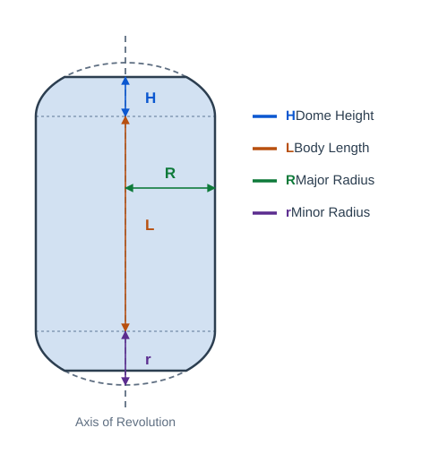
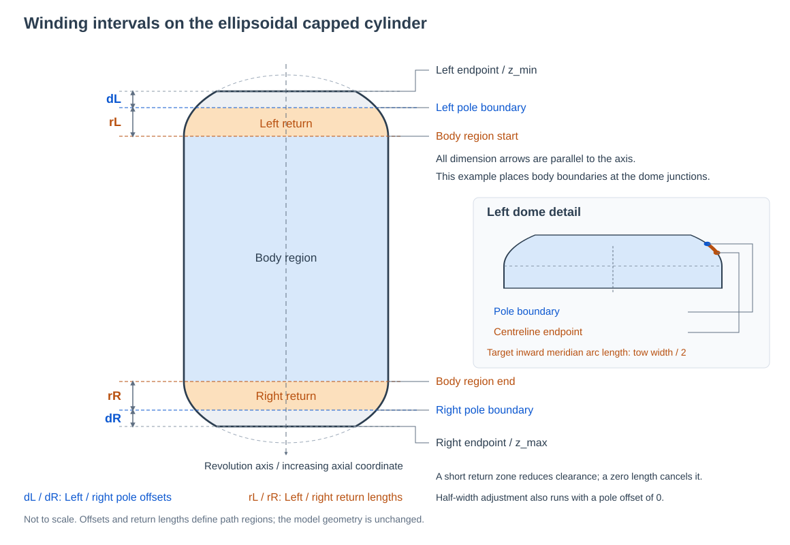

# Filament Winding

The Filament Winding module plans winding paths on axisymmetric bodies of revolution (such as pressure vessels and gas storage tanks). Currently, only axisymmetric surfaces of revolution are supported.

Show or hide the winding panel from the **Functions > Filament Winding** menu, and create geometry to use as a mandrel from **Model > Ellipsoidal Capped Cylinder**.

## 1. Creating a Winding Mandrel

Click **Model > Ellipsoidal Capped Cylinder** to create a geometry node to use as a mandrel. It is a body of revolution composed of a cylindrical body section in the middle and elliptical dome sections at both ends. The revolution axis is aligned with the Z axis, as illustrated below:



Mandrel node properties (edited in the node property panel):

- Body Length: The length of the cylindrical body section.
- Dome Height: The height of the elliptical domes at both ends.
- Major Radius: The major radius of the dome ellipses, i.e. the radius of the body section.
- Minor Radius: The minor radius of the dome ellipses.

The mandrel geometry updates in real time when parameters change. Note that the minor radius must not exceed the major radius, and the dome height must not exceed the minor radius.

## 2. Setting the Mandrel and Winding Parameters

Select a mandrel node in the scene and click **Set** in the winding panel to fill in its node path. The path field is read-only. To change the mandrel, select another node and click **Set** again.

| Parameter | Meaning | Default |
| --- | --- | --- |
| Left Pole Offset | Axial distance inward from the left model endpoint to the left pole-hole boundary | 0 mm |
| Right Pole Offset | Axial distance inward from the right model endpoint to the right pole-hole boundary | 0 mm |
| Left Return Length | Axial distance from the left pole-hole boundary toward the body, defining the boundary between the left return zone and the body region | 0 mm |
| Right Return Length | Axial distance from the right pole-hole boundary toward the body, defining the boundary between the right return zone and the body region | 0 mm |
| Friction | The input remains available in the panel; the required friction coefficient is computed for each pattern, and the current pattern search does not filter results by this input | 0.3 |
| Winding Angle | Target winding angle in the body region; on a cylindrical body, this is the angle between the path and the revolution axis | 10° |
| Angle Tolerance | Allowed angular deviation when searching for feasible winding patterns | 1° |
| Tow Width | Width of a single tow, used in both pattern calculation and the centreline adjustment at each end | 6.4 mm |
| Winding Layers | Number of layers to wind | 1 |

### 2.1 Pole-Hole Boundaries and Return Zones

Left and right refer to positions along the model's revolution axis: the endpoint with the smaller axial coordinate is the left endpoint, and the endpoint with the larger coordinate is the right endpoint. They do not depend on the viewing direction. Both pole offsets and return lengths are **axial distances**, which may differ from arc lengths along the surface meridian.

Let `z_min` and `z_max` be the axial coordinates of the model endpoints, `dL` and `dR` the left and right pole offsets, and `rL` and `rR` the left and right return lengths:

```text
Left pole-hole boundary  = z_min + dL
Right pole-hole boundary = z_max - dR
Body region start       = Left pole-hole boundary + rL
Body region end         = Right pole-hole boundary - rR
```

The intervals between the pole-hole boundaries and the body region are used for path turnaround. A pole offset of 0 places the pole-hole boundary at the model endpoint. Increasing an offset moves that boundary inward. These settings define the path calculation intervals; they do not modify the mandrel geometry or create physical holes.

Set return lengths according to the mandrel shape. The software does not automatically use the geometric junctions between the cylindrical body and the domes. For example, to start the body region at the start of the cylindrical section, set the left return length to the axial distance from the left pole-hole boundary to that junction.



For example, with model endpoints at `0 mm` and `1000 mm`, pole offsets of `50 mm` on both sides and return lengths of `150 mm` on both sides place the pole-hole boundaries at `50 mm` and `950 mm`. The body region extends from `200 mm` to `800 mm`.

Keep all boundaries within the model's axial range, with the left pole-hole boundary at or before the right boundary and the body start at or before the body end. If excessive offsets or return lengths make the intervals invalid, no path is generated; check the log for details.

### 2.2 How Tow Width Affects the Centreline

The planned path represents the tow centreline. Each calculation attempts to move the centreline inward from each configured pole-hole boundary by **half the tow width**, measured along the surface meridian, to leave room for the tow edge. This step is always part of the calculation, including when the pole offset is 0. Changing a pole offset changes the reference boundary for the adjustment.

For a tow width of `6.4 mm`, the intended adjustment is `3.2 mm` inward along the meridian. This is not a fixed axial offset: the corresponding axial distance on a curved dome depends on the surface shape.

!!! note "Return lengths limit the centreline adjustment"

    The adjusted centreline must not pass the boundary between the return zone and the body region. If the return zone cannot accommodate half the tow width, the actual adjustment is reduced. A return length of 0 limits the centreline back to the pole-hole boundary. Setting the tow width therefore does not guarantee full half-width clearance at both ends.

## 3. Computing the Winding Path

After setting the parameters, click **Compute**. The software searches for feasible integer winding patterns near the target angle and lists the results in the table:

- Pattern: The winding pattern expressed as `p/s/k/nd`.
- Phase Error: The difference between the actual winding cycle phase and the phase required by the pattern.
- Angle Error: The difference between the actual winding angle and the target angle.
- Friction: The maximum friction coefficient required by the tow for this pattern.

After the search finishes, the software automatically generates a winding ply node using the first pattern in the table. Double-clicking any row generates a winding ply with the corresponding pattern. If no feasible pattern is found, an error dialog appears. Check the intervals at both ends and try adjusting the winding angle, tolerance, tow width or layer count.

After changing the mandrel or parameters, click **Compute** again to refresh the pattern list before selecting a pattern to generate a path.

## 4. Winding Ply Node

The generated winding ply node (e.g. `WindingPly 10°`) is a trajectory node and can be used directly in simulation and post-processing.

Winding ply node properties (edited in the node property panel):

- Show Tow Strip Mesh: Shows the tow strip mesh.
- Show Tow Boundary Lines: Shows the boundary lines of the wound tows.
- Show Simulation Strip Mesh: Shows the strip mesh during simulation.

The pose of each point along the path is computed on the mandrel surface by the winding algorithm. Double-click the node to inspect its path and poses.
