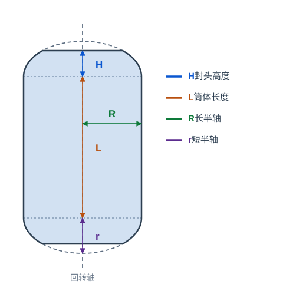
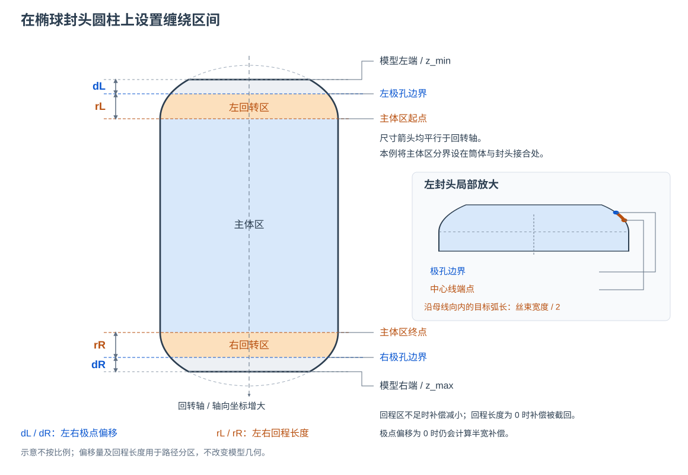

# 纤维缠绕

纤维缠绕（Filament Winding）模块用于对轴对称回转体（如压力容器、储气罐等）进行缠绕路径规划。目前仅支持轴对称回转面。

在 **功能 > 纤维缠绕** 菜单中显示或隐藏缠绕面板，在 **模型 > 椭球封头圆柱** 菜单中创建可用作缠绕芯模的几何节点。

## 1. 创建缠绕芯模

点击 **模型 > 椭球封头圆柱** 创建一个几何节点作为芯模。该几何是一个回转体，由中间的圆柱筒体段和两端的椭圆封头段组成，回转轴与 Z 轴对齐，示意图如下：



芯模节点的属性（在节点属性面板中修改）：

- 筒体长度：中间圆柱段的长度；
- 封头高度：两端椭圆封头的高度；
- 长半轴：封头椭圆的长半轴，即筒体段半径；
- 短半轴：封头椭圆的短半轴。

参数修改后芯模几何会实时更新。注意短半轴不能大于长半轴，封头高度不能大于短半轴。

## 2. 设置芯模与缠绕参数

在场景中选中芯模节点，点击缠绕面板中的 **设置（Set）** 填入节点路径。路径文本框为只读，切换芯模时需重新选择节点并点击 **设置**。

| 参数（英文界面） | 含义 | 默认值 |
| --- | --- | --- |
| 左极点偏移（Left Pole Offset） | 从模型左端沿回转轴向内定位左极孔边界的距离 | 0 mm |
| 右极点偏移（Right Pole Offset） | 从模型右端沿回转轴向内定位右极孔边界的距离 | 0 mm |
| 左侧回程长度（Left Return Length） | 从左极孔边界向主体方向量取的轴向距离，用于确定左回转区与主体区的分界 | 0 mm |
| 右侧回程长度（Right Return Length） | 从右极孔边界向主体方向量取的轴向距离，用于确定右回转区与主体区的分界 | 0 mm |
| 摩擦系数（Friction） | 当前面板保留该输入；线型所需摩擦系数由算法计算，当前线型搜索未按此输入值筛选结果 | 0.3 |
| 缠绕角度（Winding Angle） | 主体区的目标缠绕角度；在圆柱筒体上为路径与回转轴的夹角 | 10° |
| 角度容差（Angle Tolerance） | 搜索可行缠绕线型时允许的角度偏差 | 1° |
| 丝束宽度（Tow Width） | 单根丝束的宽度，同时用于线型计算和两端中心线位置调整 | 6.4 mm |
| 缠绕层数（Winding Layers） | 需要缠绕的层数 | 1 |

### 2.1 极孔边界与回转区

“左”和“右”按模型回转轴上的坐标定义：坐标较小的一端为左端，较大的一端为右端，与观察视角无关。极点偏移和回程长度均为**轴向距离**，沿曲面母线的弧长可能与之不同。

设模型两端轴向坐标为 `z_min`、`z_max`，左、右极点偏移为 `dL`、`dR`，左、右回程长度为 `rL`、`rR`，则：

```text
左极孔边界 = z_min + dL
右极孔边界 = z_max - dR
主体区起点 = 左极孔边界 + rL
主体区终点 = 右极孔边界 - rR
```

两侧极孔边界与主体区之间的区间用于路径回转。极点偏移为 0 时，极孔边界位于模型端点；增大偏移量会使对应边界向模型内部移动。这些设置用于划分路径计算区间，不会修改芯模几何或创建实际孔洞。

回程长度需要根据芯模形状设置，软件不会自动采用圆柱筒体与封头的几何接合位置。例如，要让主体区从圆柱筒体起点开始，应将左回程长度设置为左极孔边界到该起点的轴向距离。



例如，模型轴向范围为 `0～1000 mm`，左右极点偏移均为 `50 mm`，左右回程长度均为 `150 mm`，则极孔边界位于 `50 mm` 和 `950 mm`，主体区为 `200～800 mm`。

设置后应保证各边界位于模型轴向范围内，左极孔边界不超过右极孔边界，主体区起点不超过终点。偏移量或回程长度过大导致区间无效时，软件不会生成路径，可在日志中查看提示。

### 2.2 丝束宽度对中心线路径的影响

规划路径表示丝束的中心线。每次计算时，软件都会以设置后的极孔边界为基准，尝试沿曲面母线向内移动**半个丝束宽度**，为丝束边缘预留空间。该步骤始终参与计算，极点偏移为 0 时也会执行；修改极点偏移会改变补偿的基准边界。

例如，丝束宽度为 `6.4 mm` 时，目标调整量为沿母线向内 `3.2 mm`。这不是固定的轴向偏移，在弯曲封头上对应的轴向距离取决于曲面形状。

!!! note "回程长度会限制中心线调整"

    调整后的中心线不能越过回转区与主体区的分界。回程区不足以容纳半个丝束宽度时，实际调整量会减小；对应回程长度为 0 时，调整会被限制回极孔边界。因此，不能仅凭设置了丝束宽度就认为两端一定预留了完整的半宽空间。

## 3. 计算缠绕路径

设置好参数后点击 **计算**。软件会在目标角度附近搜索可行的整数缠绕线型，并将结果列在表格中：

- 线型：以 `p/s/k/nd` 表示的缠绕线型；
- 相位误差：实际缠绕周期相位与线型所需相位之差；
- 角度误差：实际缠绕角度与目标角度之差；
- 摩擦系数：该线型对应的纱线所需最大摩擦系数。

搜索完成后，软件会自动使用表格第一行的线型生成一个缠绕层节点；双击表格中的任意一行，则使用该行对应的线型生成缠绕层。如果找不到可行线型，会弹出错误提示，可检查两端区间设置，并尝试调整缠绕角度、容差、丝束宽度或缠绕层数。

修改芯模或参数后，应重新点击 **计算** 更新线型列表，再选择线型生成路径。

## 4. 缠绕层节点

生成的缠绕层节点（如 `缠绕层 10°`）是轨迹类节点，可以直接参与仿真与后处理。

缠绕层节点的属性（在节点属性面板中修改）：

- 显示带状网格：显示预浸带带状网格；
- 显示边界线：显示缠绕带的边界线；
- 仿真时显示带状网格：仿真过程中显示带状网格。

节点的路径姿态由缠绕算法在芯模表面计算得到，双击节点可查看其轨迹与姿态。
